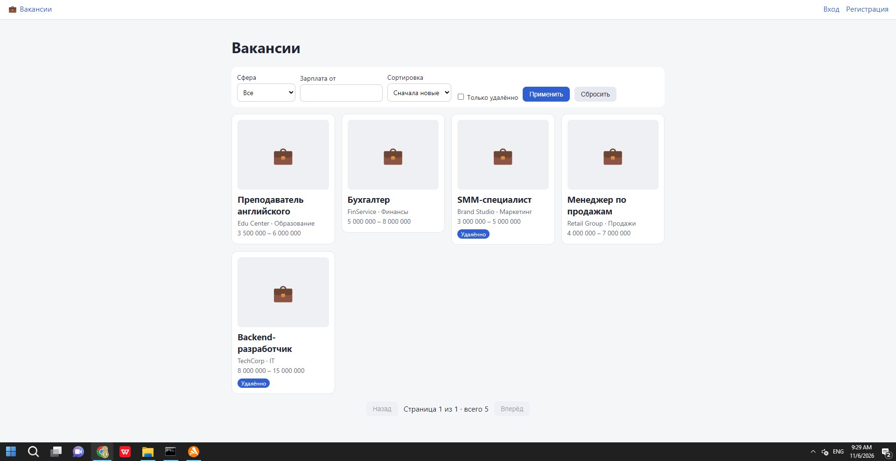
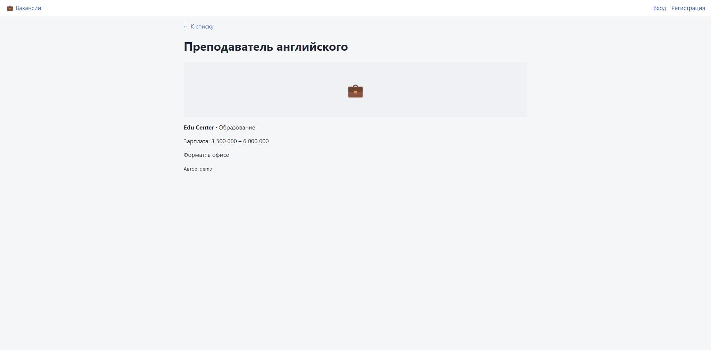
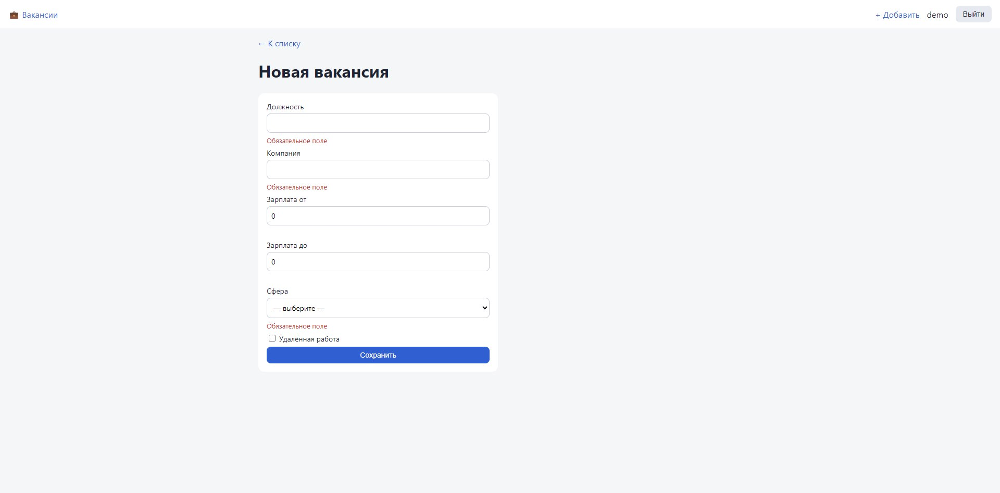
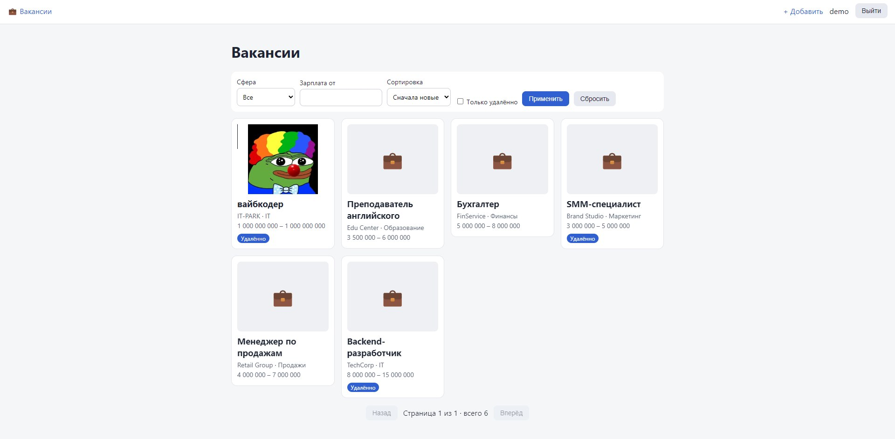

# Вакансии

**Автор:** ТВОЁ ИМЯ
**Вариант:** Закиров Ж — «Вакансии».

Вакансия: должность, компания, зарплата от и до, удалённо, логотип. Справочник: сфера.
Особое правило: «зарплата от» не больше «зарплата до» (проверка на клиенте и на сервере).

## Запуск сервера
```bash
cd server
dotnet user-secrets set "Jwt:Key" "любая-длинная-строка-не-короче-32-символов"
dotnet run
```
Сервер: http://localhost:5001, документация: http://localhost:5001/scalar/v1.
База `jobs.db` создаётся сама (миграции применяются при старте).

## Запуск клиента
```bash
cd client
npm install
ng serve --proxy-config proxy.conf.json
```
Клиент: http://localhost:4200

## Тестовый пользователь
Логин: `demo`  Пароль: `Demo123!`

## Эндпоинты

| Метод | Адрес | Доступ | Ответы |
|---|---|---|---|
| POST | `/api/auth/register` | все | 200, 400 |
| POST | `/api/auth/login` | все | 200, 401 |
| GET | `/api/spheres` | все | 200 |
| GET | `/api/jobs` | все | 200 |
| GET | `/api/jobs/{id}` | все | 200, 404 |
| POST | `/api/jobs` | вошедший | 201, 400, 401 |
| PUT | `/api/jobs/{id}` | автор | 200, 400, 401, 403, 404 |
| DELETE | `/api/jobs/{id}` | автор | 204, 401, 403, 404 |
| POST | `/api/jobs/{id}/logo` | автор | 200, 400, 401, 403, 404 |

Параметры `GET /api/jobs`: `page`, `pageSize`, `sphereId`, `remote=true`, `minSalary` (зарплата от),
`sort` = `salary` (по зарплате, сначала большие) или `newest` (новые, по умолчанию).
В ответе: `items`, `page`, `pageSize`, `total`.

Логотип: jpg, png или webp, до 5 МБ, имя на сервере Guid.
Запросы ко всем эндпоинтам: `server/jobs.http`.

## Скриншоты

### Список


### Страница записи


### Форма с ошибками


### Загруженный логотип

